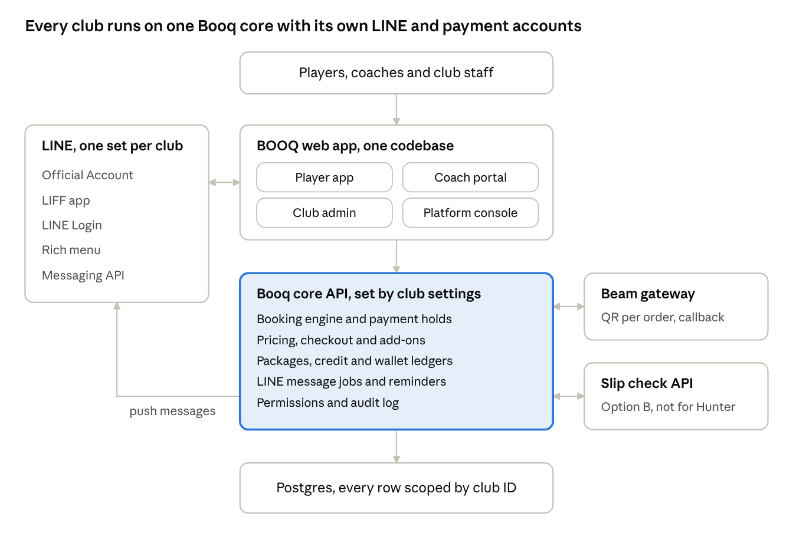

# BOOQ Hunter · Developer Hand-off v1.2

Oct 30, 2026 · @Criclabs

## Overview

Build Hunter Tennis Club's booking app as the first club on the Booq core. There is no earlier Booq code or database, so Hunter is the first real build and the core is created with it (decision 30 Oct 2026). The Notion Booq Product Reference is superseded by this doc and the PRD, running as a LINE LIFF app, live for public booking on 29 Dec 2026. Hunter testing starts 7 Dec 2026.

| Item         | Value                                                                                                                    |
|--------------|--------------------------------------------------------------------------------------------------------------------------|
| Club         | Hunter Tennis Club, legal name บริษัท ทีที รีครีเอชั่น จำกัด, tax ID 0135569018041, head office                                   |
| Courts       | 2 tennis courts, one location                                                                                            |
| Surfaces     | Player app (LIFF, 375 px), club admin console (desktop, 1280 px), coach portal (mobile), BOOQ platform console (desktop) |
| Payments     | Beam payment gateway for Hunter. Slip checking stays as the second option for other clubs                                |
| Booking unit | 60 minutes on the hour, every club                                                                                       |
| Languages    | Thai and English, switchable everywhere                                                                                  |

**Sources of truth.** [Product Requirements v1.2](https://claude.ai/artifact/9UxUdHBqyqaSGPNKbWYHsg) for rules and decisions. [Design canvas](https://claude.ai/artifact/3Jo8snhzdEXEhVhrRqi3ea) for every screen, state and clickable flow. Where they disagree, the spec wins and the gap is a bug in the canvas.

**How to read the canvas.** Pages run Step 0 (sitemap and flows), Step 1 wireframes, Step 2 visual direction, Step 3 hi-fi, Step 4 states and Thai, Step 5 LINE and receipts, Step 6 clickable flows. Build from hi-fi boards (prefixed H-, G-, S-, T- for Thai). Wireframes explain intent only.

## How we build: Spec-Driven Development with Claude Code

We build with Spec-Driven Development (SDD). Every feature gets a written spec in the repo before any code, and Claude Code implements from that spec one task at a time. The requirement IDs in this doc (such as BOOK-03) are the IDs the specs, tasks, tests and commits use.

**Repo layout**

CLAUDE.md project rules Claude Code reads every session  
locales/  
en.json English text by key (P-0004 ...)  
th.json Thai text by the same keys  
copy-index.csv every key with its screens and canvas boards  
specs/  
product/prd-v1.2.md export of Product Requirements v1.2  
product/handoff-v1.2.md export of this doc  
features/F03-court-booking/  
requirements.md user stories + acceptance criteria with IDs  
design.md data, API, states, screens by canvas ID  
tasks.md ordered checklist, each task names its IDs

**The loop for each feature**

1.  **Requirements.** Claude Code drafts requirements.md from the PRD and this doc. Each requirement keeps its ID and gets acceptance criteria in Given, When, Then form. A person approves it.

2.  **Design.** Claude Code drafts design.md: tables and migrations, API routes, state machine, permission checks, and the canvas boards it builds from. A person approves it.

3.  **Tasks.** Claude Code breaks the design into small tasks in tasks.md, each under a day of work and each naming the requirement IDs it covers.

4.  **Build.** One task per run. Tests are written first from the acceptance criteria, then the code. The task is ticked and the commit message names the IDs, for example BOOK-03 hold slot for payment window.

5.  **Change.** A rule change starts in the PRD, then this doc, then the feature's requirements, design and tasks. Code never gets ahead of the spec.

**What goes in CLAUDE.md**

- The spec in specs/ is the source of truth. If code and spec disagree, stop and ask, never guess a rule.

- Never invent prices, amounts or settings. Values marked TBD in the PRD are club settings with no default.

- Every query is scoped by club ID. Permissions are checked on the server.

- All times in Asia/Bangkok. Money as integer satang.

- Never write user facing text in the code. Every text comes from locales/en.json and locales/th.json by key (see Text and language files).

- Run the tests and type checks before ticking a task.

**Feature backlog, in build order**

| \#  | Feature spec                                                             | Requirement IDs | Depends on |
|-----|--------------------------------------------------------------------------|-----------------|------------|
| F01 | Platform foundation: clubs, locations, resources, roles, settings, audit | PLAT            | Booq core  |
| F02 | LINE Login, LIFF and first sign in                                       | AUTH            | F01        |
| F03 | Court booking, schedule and payment hold                                 | BOOK            | F01, F02   |
| F04 | Checkout, pricing, add-ons and promo codes                               | PAY, PROMO      | F03        |
| F05 | Beam payments (Hunter launch)                                            | PAY             | F04        |
| F06 | Packages, credit and wallet ledgers                                      | PKG             | F04        |
| F07 | Solo classes, coach picker and rest rule                                 | COACH           | F03, F06   |
| F08 | Group classes and waitlist                                               | CLASS           | F06        |
| F09 | Cancellation and closures                                                | CANCEL          | F06        |
| F10 | LINE messages and rich menu                                              | LINE            | F03        |
| F11 | Club admin console A0 to A17                                             | ADMIN           | F03 to F09 |
| F12 | Coach portal K1 to K6                                                    | COACH           | F07        |
| F13 | Receipts, reports and daily close                                        | RCPT            | F05        |
| F14 | Referrals and birthday discount                                          | PROMO           | F06        |
| F15 | Platform console P1 to P6                                                | PLAT            | F01        |
| F16 | Slip checking option and backup mode (not needed for Hunter launch)      | PAY             | F04        |

Thailand's PDPA, Thai and English, and the no double booking rule apply to every feature, so each design.md says how it meets them.

## Text and language files

Development starts now with the draft copy, and the writers' refined copy replaces it later with no code changes. This works only because no text is ever written into the code.

| ID      | Requirement                                                                                                                                                 | Acceptance check                                          |
|---------|-------------------------------------------------------------------------------------------------------------------------------------------------------------|-----------------------------------------------------------|
| TEXT-01 | Every user facing text (screens, LINE messages, receipts, errors) comes from locales/en.json and locales/th.json by key                                     | A search of the code finds no hard coded user facing text |
| TEXT-02 | Keys match the writers' spreadsheets: P player app, A club admin, K coach portal, L LINE and receipt, X platform console. One key can serve several screens | copy-index.csv lists every key in use                     |
| TEXT-03 | Sample values in a text (names, dates, prices, counts) become named variables such as {amount} in both files, keeping the same key                          |                                                           |
| TEXT-04 | Developers never change the wording of an existing key. New text gets a new key in both files and goes to the writers                                       |                                                           |
| TEXT-05 | The platform console is English only. Everything else ships in Thai and English                                                                             |                                                           |
| TEXT-06 | Layouts survive the longest string in either language. Buttons never wrap; content areas scroll                                                             |                                                           |

**How refined copy comes back**

1.  Writers fill in the yellow column of their spreadsheet (English writer and Thai writer workbooks) and send them back.

2.  Claude turns the edited rows into new en.json and th.json and updates the matching canvas screens. Developers replace the two files.

3.  Any row the English writer rewrote is flagged so the Thai writer checks its Thai again.

4.  Rows that describe a rule (cancellation, packages, payments) are flagged for a product check, so a wording change never changes a rule by accident.

5.  Privacy consent, receipt and payment text must be final before testing starts on 7 Dec 2026.

## Architecture

Hunter is the first club on the existing Booq core (Notion Booq Product Reference). Nothing is written only for Hunter: tennis, two courts, ฿500 an hour and Beam are all club settings.

system architecture · one codebase, per club accounts

One web app serves four surfaces from one codebase, inside LINE as a LIFF app or in a browser. The core API owns every rule; the surfaces only show and collect. Beam and the slip check API sit behind the core, so switching a club's payment option changes no screen code.

**Suggested stack** (not a requirement): Next.js with the LIFF SDK, Postgres such as Supabase with row level security by club ID, server jobs for holds, reminders and expiries. Booq core naming differs: Notion says Store and Branch, this design says Club and Location. Keep the core's table names and map the labels in the UI.

## Data model

Every record carries a club ID, and nothing is shared between clubs. Credits and wallet are ledgers of movements, never one editable number.

| Record                        | Key fields                                                                                                                          | Notes                                                           |
|-------------------------------|-------------------------------------------------------------------------------------------------------------------------------------|-----------------------------------------------------------------|
| Club                          | Name TH/EN, legal name, tax ID, branch, registered address, status (draft, testing, live, paused), payment option, feature switches | One LINE OA, LIFF app and rich menu per club                    |
| Location                      | Club, name, branch label                                                                                                            | Hunter has one, Main location · Head office                     |
| Resource (court)              | Location, name, sport, type, lights, max players, active                                                                            | Sport drives labels (court, table, lane)                        |
| Opening hours                 | Club, weekday, open, close                                                                                                          | Hunter 06:00 to 24:00 daily                                     |
| User                          | Club, LINE user ID, full name, phone, date of birth, language, level, role, tags, staff notes                                       | LINE user ID is the key. A player at two clubs has two accounts |
| Price group                   | Club, name, rule                                                                                                                    | Hunter: Adult (18+), Student (under 18, by date of birth)       |
| Court price rule              | Club, price group, weekday or weekend, off peak or peak, price                                                                      | Hunter uses one price, ฿500 everywhere                          |
| Coach                         | User, bio TH/EN, certifications, specialties, tier, price override, pay model                                                       |                                                                 |
| Coach tier                    | Club, name, price per price group                                                                                                   | Head Coach, Coach                                               |
| Availability rule and leave   | Coach, weekday or date, start, end, open or closed; leave dates, type, status, approver                                             | Rest rule caps 6 teaching hours in a row                        |
| Booking                       | Club, type (court, solo class, class seat), resource, start, end, customer, coach, status, source                                   | A solo class always holds both coach and court                  |
| Class template and session    | Name TH/EN, audience, level, coach, court, weekday, time, min and max players; session date and status                              | Always 60 minutes                                               |
| Waitlist entry                | Customer, session or slot, position, offer sent, offer expires                                                                      |                                                                 |
| Package product               | Club, name TH/EN, credit type, credits, validity, price group, tier, price, active                                                  | Generic hour bundles and class packs                            |
| Customer package              | Customer, product, credits total, purchased at, expires at, extension reason                                                        |                                                                 |
| Credit ledger                 | Package, change, reason (reserve, return, use, forfeit, expire, adjust, import), booking, staff                                             |                                                                 |
| Wallet ledger                 | Customer, change in THB, reason, booking or referral, staff. Reasons: refund, late_payment, wrong_amount, duplicate_payment, referral_reward, spend, return, adjust, import, and expire only if wallet expiry is set | Never withdrawn as cash                                         |
| Add-on                        | Club, name TH/EN, price, active                                                                                                     | Hunter: racket, Balls (Set of 3 balls), towel, water            |
| Order and payment             | Items, add-ons, discounts, amount due, method (Beam, slip, cash, credit), gateway or slip reference, status                         |                                                                 |
| Promo code, partner, referral | Code, discount, scope, audience, dates, caps, stackable, partner; referrer, referred, reward status                                 | One code per order                                              |
| Closure                       | Resources, start, end, repeat, reason, staff                                                                                        |                                                                 |
| Receipt                       | Sequential number per club, order, issued at, VAT flag, void reason                                                                 | Numbers never reused                                            |
| Audit entry                   | Actor (club staff or BOOQ staff), time, record, old value, new value, reason                                                        | Platform actions also go to the P6 log                          |

**Integrity rules.** Court and coach are reserved in one transaction with a uniqueness rule, including during the payment hold. A solo class reserves both or neither. All times are Asia/Bangkok. Permissions are enforced on the server.

## Screen inventory

Build from the hi-fi boards. Each English board has a Thai twin with the same name and a T- prefix (Steps 4.2 to 4.5). Extra states sit on the G- (gaps) and S- (states) boards.

| Surface              | Screens                                                                                                                                                                                                                                                                                                                       | Canvas boards                                                                             | Feature       |
|----------------------|-------------------------------------------------------------------------------------------------------------------------------------------------------------------------------------------------------------------------------------------------------------------------------------------------------------------------------|-------------------------------------------------------------------------------------------|---------------|
| Player app, booking  | C1 sign in at checkout, C2 quick profile, C3 Home (signed in, guest, paused), C4 Book a court, C10 Checkout (with coach picker), C11 Pay (Beam for Hunter, slip for others), C12 Confirmed                                                                                                                                    | H-C01 to H-C12, G-C10-Coach-picked, S-C03-Guest, S-C03-Paused, S-C04 states, S-C11 states | F02 to F05    |
| Player app, classes  | C5 Solo classes, C6 Coach profile, C7 Group classes, C8 Class detail, C10b solo checkout, C16 Waitlist offer                                                                                                                                                                                                                  | H-C05 to H-C08, H-C10b, H-C16                                                             | F07, F08      |
| Player app, packages | C9 Packages (3 tabs), C10P package checkout, C10c bundle prompt, C11P pay for a package, C12P purchase confirmed                                                                                                                                                                                                              | H-C09 to H-C12P, G-C11P-Beam-package                                                      | F06           |
| Player app, account  | C13 My bookings, C13b Cancel sheet, C14 Credits and wallet, C15 Refer a friend, C17 Profile and receipts                                                                                                                                                                                                                      | H-C13 to H-C17, G-C13, G-C17                                                              | F06, F09, F14 |
| LINE                 | Rich menu (6 tiles, each a deep link), Booking confirmed card, Reminder, Waitlist offer                                                                                                                                                                                                                                       | L-Rich-menu, L-Msg-\*                                                                     | F10           |
| Receipts             | PDF receipt, Thai and English, A4                                                                                                                                                                                                                                                                                             | R-Receipt-TH, R-Receipt-EN                                                                | F13           |
| Club admin           | A0 Setup checklist, A1 Calendar, A2 Booking create and detail, A4 Backup slip check (slip clubs only), A5 Customers, A6 Customer profile, A7 Coaches, A8 Group classes, A9 Products and pricing, A9b Price groups and add-ons, A10 Promotions, A12 Closures, A13 Reports, A14 Receipts, A16 Settings, A17 Staff and audit log | H-A0 to H-A17, G-A02b, G-A02c, G-A13b, S-A01-Paused                                       | F11           |
| Coach portal         | K1 Today, K2 Schedule, K3 Availability, K4 Leave, K5 Session detail, K6 Earnings                                                                                                                                                                                                                                              | H-K1 to H-K6                                                                              | F12           |
| Platform console     | P1 Clubs, P2 New club (5 steps, Beam or slip), P3 Club detail, P3b setup only support view, P3c Pause, P4 Launch, P5 Templates, P6 Team and audit                                                                                                                                                                             | H-P1 to H-P6                                                                              | F15           |

**Removed, do not build.** A3 Check-in and any check in QR, A11 Gift vouchers, A15 Messages editor, the everyday slip review queue.

**Clickable flows (Step 6).** F1 Hunter player books and pays with Beam, F1b player at a slip checking club, F2 buy a package then book with it, F3 front desk walk in, F4 BOOQ onboards a club, F5a fix a LINE alert, F5b pause a club. All links were click tested on 30 Oct 2026.

## Business rules as requirements

These are the starting requirements for the feature specs. Each acceptance check becomes at least one test. Values in brackets are club settings, shown with Hunter's value.

| ID        | Requirement                                                                                                                                                | Acceptance check                                                                                                                            |
|-----------|------------------------------------------------------------------------------------------------------------------------------------------------------------|---------------------------------------------------------------------------------------------------------------------------------------------|
| AUTH-01   | Players browse without signing in. LINE Login runs only at checkout or purchase. A Draft or Testing club admits the owner role and testers; the owner invite link stays valid for return visits and testers get long lived invites. A club that is not live serves only a minimal sign in config (name, language, status, LIFF id) to callers who are not signed in. A guest reads only named public columns or routes, never owner contact details or merchant ids | Given a guest on C4, when they tap Continue, then LINE Login starts and they return to C10 with the slot kept                               |
| AUTH-02   | First sign in asks only full name, phone and PDPA consent. Date of birth only for a student price. Players can correct it later in Profile; it is never locked. Phone is typed, not verified by code; duplicate phones at one club are flagged for staff. A player with no date of birth gets Adult prices; an adult may add a date of birth voluntarily; every change to it is audited and visible to the owner | Given a new player, when they pick an Adult item, then no date of birth field shows                                                         |
| BOOK-01   | Bookings are 60 minutes on the hour, inside opening hours, up to \[30\] days ahead. Players cannot book an hour that has already started (booking starts from the next full hour); staff can book it for walk ins. 23:00 is the last start. The booking window runs to today plus [30] days by Bangkok calendar date, so day 30 is bookable. Changing opening hours or removing a court while bookings exist is blocked; the owner uses a closure instead | A request for 18:30 or 61 days ahead is refused by the server                                                                               |
| BOOK-02   | The rich menu Book a court tile opens C4 directly                                                                                                          | Tapping the tile lands on C4, not C3                                                                                                        |
| BOOK-03   | Tapping Pay holds the slot (and the coach, if picked) for \[15\] minutes, choice 10, 15 or 20. A staff made booking awaiting payment holds the slot for the same hold time. A second tap on Pay returns the same hold and QR. A hold keeps its original end time if the hold setting changes. A closure over a held slot cancels the hold and tells the player; a payment that arrives later follows PAY-03 | Given a held slot, then other players see it as held and cannot select it; after the hold it is released and the player gets a LINE message |
| BOOK-04   | No double booking of a court or a coach, including during holds                                                                                            | Two parallel requests for the same slot: exactly one succeeds                                                                               |
| BOOK-05   | A player holds at most \[TBD\] future court hours. Counts all of the player's future hours: confirmed, paid by bundle credit, solo class and unpaid held hours. Staff bookings count, but staff can override the limit with a logged reason. Group class seats are not counted. A per-player limit on repeated Pay taps is a platform setting whose value Security sets. Only staff (front desk, owner) may override the limit, with a logged reason; no running hour or same date rule is built | Setting left empty means no limit until the owner sets it                                                                                   |
| BOOK-06 | A selection of several hours is one order with one booking per hour, so cancel, no show and the future hours count work hour by hour; one receipt per order. There is no separate limit on hours in one selection (BOOK-05 governs) | Given a two hour selection, when the player cancels one hour, then only that hour is cancelled |
| WAIT-01 | The court slot waitlist uses the same rules as the class waitlist (claim time, no offers within the cut off). F08 owns it; F03 shows Join waitlist on a taken slot | Given a taken slot, when the player taps Join waitlist, then they are added with a position and nothing is charged |
| COACH-01  | C10 shows only coaches who work that hour, are not on leave, not booked and under 6 hours in a row. Only approved leave hides a coach; a pending request shows a warning in A7 | A coach on leave never appears; a 7th hour in a row never appears                                                                           |
| COACH-02  | Picking a coach makes it a solo class: court ฿500 plus that coach's price for the player's price group. The coach price follows the player's price group from the date of birth, so a player under 18 pays the Student coach price. A booked session keeps its price when a tier or price changes. When both courts are open the court already booked is used, otherwise the lowest numbered open court | Adult with a Coach tier coach pays ฿1,300                                                                                                   |
| COACH-03  | Solo pack credits do not apply to a coach added at court checkout. They apply only when booking through Classes, Solo classes. Solo credits do not apply to a coach added after booking. A coach profile photo and bio are published with the coach's consent, which the club keeps. Substitutes follow the rest rule; if none is free the owner cancels for full credit. A coach with future sessions cannot be deactivated until they are moved | Given a player with solo credits, when they add a coach on C10, then the full coaching price is charged                                     |
| COACH-04  | With a solo pack credit, the ฿500 court is still paid by a bundle hour, wallet or payment                                                                  | Solo booking with a credit shows the court line due                                                                                         |
| PKG-01    | Credits and wallet are ledgers. Every movement has a reason and, for staff, a written note. A staff adjustment can never take a balance below zero | Balance always equals the sum of its ledger rows                                                                                            |
| PKG-02    | Bundles: 10 hours ฿4,500 for 3 months, 20 hours ฿8,000 for 5 months. Class packs are 8 sessions for 3 months. A player who turns 18 keeps using the Student credits they bought, for the Student items they were bought for, until expiry; the class list shows them those items while they hold such credit | Expiry date = purchase date plus validity. A Student package stays valid after the holder becomes an Adult                                                                                                   |
| PKG-03    | Expiry reminders 14 and 3 days before. Expired credits are lost unless the owner extends with a reason. A credit reserved before the package expires stays valid for that session; if that booking is cancelled after the package expired, the credit is lost. The owner extends one package at a time with a written reason; there is no bulk extension in v1. An empty wallet expiry setting means wallet balances never expire, and staff are warned when it is first set that existing balances will start to expire. A pause shorter than a day moves the expiry by the exact pause length and the expiry then runs to 23:59 on the resulting day. If a package bought with a booking is paid late and the booking cannot be confirmed, all of it goes to the wallet. The 14 day and 3 day expiry reminders and the 24 hour and 2 hour booking reminders are variables in the text and settings in code |                                                                                                                                             |
| CANCEL-01 | Cancel 12 hours or more before start returns full value: credit to its package, money to the wallet. Later, or no show, forfeits. The birthday entitlement follows the code rule: restored only when every hour of an order is cancelled. Staff cancelling at the desk may choose a club cancel with full value and a reason. A player may cancel an existing booking while the club is paused | The cancel sheet states the outcome before confirming                                                                                       |
| CANCEL-02 | Value never returns as cash. The wallet can't be withdrawn                                                                                                 | No cash refund action exists anywhere                                                                                                       |
| CANCEL-03 | A club closure cancels affected bookings with full credit back and a LINE message. A repeat closure cancels bookings across the booking window. If a package expired before a closure return, the closure screen lists the affected packages and the owner extends them with a written reason. The owner gets a list of players who could not be messaged |                                                                                                                                             |
| CANCEL-04 | There is no check in. A confirmed booking counts as played when its slot ends. Staff mark a no show or late cancel in A2 with a reason, and can reverse it. Staff can mark a no show only after the slot ends. Reversing a no show or late cancel changes coach pay by the normal rule (attended or no show counts, a cancel within policy does not); a referral reward already paid stays paid. A coach marking a player Absent in K5 is a hint to staff and does not change the booking |                                                                                                                                             |
| CLASS-01  | Group classes are 60 minutes, 4 to 6 players by default. Students see Student classes only, adults Adult only. Sessions are generated across the booking window. A player sees classes of their own price group and also those matching credits they hold, so an under 18 player holding an Adult pack sees Adult classes. A guest sees the Adult schedule. Editing a template applies to future sessions without players; a session that already has players keeps its details unless the owner edits it, and the players are messaged with a free cancel. Until the below minimum alert time is set, a below minimum session runs |                                                                                                                                             |
| CLASS-02  | Waitlist: first in line gets a LINE offer with \[30\] minutes to claim. No offers within \[2\] hours of start. While an offer is open the spot is held for the first in line; an offer open at the 2 hour mark still stands. Claim is confirmed on the tap when credit or wallet covers it; when money is due Beam payment is needed inside the claim time. There is no maximum waitlist length, and one player may be on several waitlists |                                                                                                                                             |
| PROMO-01  | One promo code per order. The owner decides per code whether it stacks with the birthday discount. A player under 18 may buy Adult items. If a code does not stack with the birthday discount, the one giving the larger discount applies. A code use is counted at Pay and given back when the hold ends or the booking is cancelled 12 hours or more ahead; a discount is split across the hours of an order by each hour's price, and cancelling one hour restores that hour's share (the code use is restored only when every hour is cancelled). Minimum spend is checked on the order total before credits and wallet. A restored code reduces the partner redemption count. The birthday discount applies to the whole solo class price, and the entitlement resets each Bangkok calendar year |                                                                                                                                             |
| PROMO-02  | Referral reward lands in the referrer's wallet after the friend's first paid booking is played. Self referral blocked by LINE ID and phone. The referrer is not named to the friend. The reward uses the amount in force when the friend's booking is played; if it is empty then, no reward is paid. The friend's booking counts only if money was paid; a cancelled booking never counts and the reward waits for the next qualifying booking. The referrer is recorded at the friend's first sign in through the link, with no time limit. There is no reward cap in v1. A friend is new when they have no earlier paid purchase |                                                                                                                                             |

The rest of the rules (coach pay, substitutions, reports, daily close) are in the PRD sections Coach portal and admin console and Solo classes and coach rules.

## Payments and receipts

Hunter launches on Beam: each booking or order gets its own PromptPay QR from Beam, and Beam's callback confirms it, so there is no slip. Money goes straight to the club's own Beam merchant account, never through BOOQ.

| ID      | Requirement                                                                                                                                                                                | Acceptance check                                                |
|---------|--------------------------------------------------------------------------------------------------------------------------------------------------------------------------------------------|-----------------------------------------------------------------|
| PAY-01  | Each club picks one payment option in P2 step 5: Beam, or PromptPay with slip checking                                                                                                     | Hunter's club record says Beam; C11 shows the Beam screen       |
| PAY-02  | Beam: create a QR for the exact amount when the player taps Pay; confirm the booking only on Beam's verified callback. A validly signed callback for an unknown charge is answered with success and flagged; a bad signature is rejected. If a charge fails inside the hold, a second tap on Pay creates a new charge in the same hold. If a callback never arrives, the server may check Beam's charge status and confirm only when the amount and reference match, recorded in the audit log. Only the order reference is sent to Beam. The QR expiry is set slightly before the hold ends, with the margin a platform setting. A wrong amount: the player sees that the payment was received and the club is checking; staff credit the full amount received to the wallet, which also gets its own receipt. A wrong amount alert shows as an owner banner in the admin; a bad signature, failed key check or unreachable Beam shows in P1, and a failed key check also reaches the owner | A callback with a bad signature or wrong amount changes nothing |
| PAY-03  | Beam payment after the hold ends: approve if the slot is still open, else put the value in the wallet (confirmed 30 Oct 2026). The wallet credit gets its own receipt for the money received. Other reasons to refuse a late payment besides a taken slot: a paused club, a closure, a deleted account. In those cases the whole value goes to the wallet. A duplicate payment credit gets its own receipt, and the wrong amount notice reaches the player in the app and by LINE when it can be sent |                                                                 |
| PAY-04  | Package bought alone: nothing is held, the QR is valid \[15\] minutes, then the order is cancelled and nothing is charged. The package QR time is its own setting (default [15] minutes). A payment that arrives after the package order was cancelled goes to the wallet and gets its own receipt |                                                                 |
| PAY-05  | Refunds never go back as cash. Wallet or credit only (CANCEL-02)                                                                                                                           |                                                                 |
| PAY-06  | Front desk can take cash in A2 with a reason code                                                                                                                                          |                                                                 |
| PAY-07  | Nothing left to pay (credits or wallet cover it) confirms at once with no QR. A receipt is still issued, in the same numbered series, showing how it was paid. The server prices at Pay; if the price changed since the player opened checkout, they see the new price and confirm again. Amounts show as whole baht when whole, otherwise with two decimals |                                                                 |
| PAY-08  | Slip checking option (F16, other clubs): slip upload, automatic check, popup with Chat with us on LINE, backup mode with 60 minute holds and A4                                            | Not needed for Hunter's launch                                  |
| RCPT-01 | Every payment gets a receipt numbered per club in an unbroken sequence (HTC‑2027‑000001). Void needs the owner and a reason; numbers are never reused. The number runs per club per Bangkok year (HTC-2027-000001, then HTC-2028-000001). A void only marks the receipt and never touches the booking, credit or wallet. No credit note is issued when value goes back to the wallet; a duplicate payment credit gets its own receipt. The receipt prefix is set in P2 step 1 and is required before Go live. A reprint is in the player's language; staff may print either language |                                                                 |
| RCPT-02 | Receipt shows บริษัท ทีที รีครีเอชั่น จำกัด, tax ID 0135569018041, head office, the registered address, customer, items, discounts, method and total. Non VAT by default, with a VAT invoice switch | Both PDF receipts match R-Receipt-TH and R-Receipt-EN           |
| RCPT-03 | A daily close totals each payment method for matching against the bank. The daily close lists the money methods (Beam, cash) and shows wallet and credit use as separate lines that are not money. A closed day cannot be reopened; a void made later shows on the day it is made, with a reference to the original receipt |                                                                 |

**Open for setup, not for code.** Hunter's Beam merchant account and Beam's confirmed fees. The slip checking provider is chosen only when a club picks that option.

## LINE integration

Each club has its own LINE Official Account, LINE Login channel, LIFF app and rich menu under one provider. The LINE user ID is the player's permanent key within that club.

| ID      | Requirement                                                                                                                                                                                                                                                                       | Acceptance check                  |
|---------|-----------------------------------------------------------------------------------------------------------------------------------------------------------------------------------------------------------------------------------------------------------------------------------|-----------------------------------|
| LINE-01 | Inside LINE, LIFF login is silent. In a browser the player taps Log in with LINE once. Sign in prompts adding the OA as a friend. Add the Official Account as a friend through LINE's own consent screen (the LIFF add friend option set to On normal); C1 shows a plain note and has no checkbox (30 Oct 2026) |                                   |
| LINE-02 | Rich menu has 6 tiles, each a deep link to its own page: Book a court (C4), Solo classes, Group classes, Packages, My bookings, Refer a friend. The rich menu is one image with Thai and English labels together, rendered on the server from the owner's six labels | Each tile opens its page directly |
| LINE-03 | Messages are push messages from the club's OA in the player's language, with fixed Thai and English wording in code. Templates fill in the club's name, logo and rules. A queued message uses the player's language at send time. Staff and coaches have their own language field, defaulting to their LINE app language | No message editor in the admin    |
| LINE-04 | Booking confirmed is a Flex Message rich card sent the moment a booking confirms: court or class, date, time, coach, amount paid, receipt number, View booking and Add to calendar                                                                                                | Matches L-Msg-Confirmed           |
| LINE-05 | Other messages: reminders 24 h and 2 h before, booking released, cancellation result, club closed this slot, coach changed, waitlist offer, package expiring 14 and 3 days before, birthday discount, referral reward, coach session changes, leave decision, class below minimum. Booking released is also sent to Beam clubs when the hold ends. A booking made less than 24 or 2 hours before start skips the reminders already past. Profile switch Booking reminders in LINE controls the 24 hour and 2 hour reminders; Promotions in LINE controls the birthday discount and referral reward messages; all other messages are always sent. Package expiring is always sent. The other 11 messages use the writers' wording on the Confirmed card style, with no separate board in v1 |                                   |
| LINE-06 | P1 shows LINE messages used this month per club against its plan, and alerts when the Messaging API token fails. When the LINE token fails the owner sees a banner in the admin and BOOQ sees an alert in P1. The owner edits the six rich menu labels in Settings after Go live, which re renders the image |                                   |
| LINE-07 | Message cap: at 70% of the plan's monthly limit show an alert in P1 and a banner in the club admin; at 80% stop sending the 24 h and 2 h reminders and keep every other message; at 100% on a paid plan keep sending and tell the owner, on the free plan show the confirmation in the app and pass unsendable waitlist offers on. Bookings and payments are never blocked. Thresholds are platform wide. If LINE's usage cannot be read, use the last known value and raise an alert in P1; reminders are not stopped. The 70 percent banner uses the same style as the pause banner. If the owner upgrades the LINE plan mid month, LINE's own count decides | Given a club at 80% of its limit, when a booking is confirmed, then the confirmation is sent and no reminder is queued |

About 3 to 4 push messages go out per booking, so Hunter needs a paid LINE OA plan. The club pays for it directly.

## Roles, platform console and data protection

Permissions are enforced on the server and every record is scoped to one club. BOOQ staff never see a club's customer or payment data.

| Role                      | Surface                | Can                                                                                  | Cannot                                                               |
|---------------------------|------------------------|--------------------------------------------------------------------------------------|----------------------------------------------------------------------|
| Player (adult or student) | Player app             | Book, buy, pay, cancel, see own credits, receipts and referrals                      | See other players                                                    |
| Coach                     | Coach portal           | Own schedule, availability, leave, attendance, notes, own earnings                   | See other coaches, payments or revenue                               |
| Front desk                | Club admin             | Bookings, walk ins and cash, customers                                               | See revenue or coach pay, change prices, rules or staff              |
| Accountant                | Club admin, finance    | Read and export reports and receipts                                                 | Change bookings, prices or balances                                  |
| Owner                     | Club admin, everything | All of the above plus prices, packages, promotions, rules, staff, coach pay          |                                                                      |
| Platform admin            | Platform console       | Create and set up clubs, change status, pause with a reason, setup only support view | See players, bookings, payments, slips, receipts, wallets or reports |
| Onboarding specialist     | Platform console       | Same as platform admin for assigned clubs                                            | Pause or delete clubs                                                |

| ID      | Requirement                                                                                                                                                                                                                        |
|---------|------------------------------------------------------------------------------------------------------------------------------------------------------------------------------------------------------------------------------------|
| PLAT-01 | Club status runs Draft, Testing, Live, Paused. Go live needs every check in P4 passed. If the owner has not signed in, P1 shows an alert and P3 offers a fresh invite bound to the owner's LINE ID. The club's URL name is set in P2 step 1, is unique, may change in Draft or Testing and is fixed after Go live. BOOQ staff enter the Beam merchant ID, test and live keys and the signing key at setup; they are write-only. Go live needs only the rules required for booking to work; empty TBD values do not block it. There is no billing in v1: trial end and billing start are dates BOOQ keeps |
| PLAT-02 | Support view shows setup only: courts, products and pricing, LINE, payment connections, settings. Draft and Testing clubs are editable; Live clubs are look only unless the owner turns on Allow BOOQ to make changes for 24 hours |
| PLAT-03 | Pausing turns off new booking and buying, keeps existing bookings and reminders, moves package and wallet expiry forward by the pause length, and shows a banner in the club admin. A paused club also refuses new holds from staff; the owner can still manage existing bookings |
| PLAT-04 | Every change to a booking, balance, price or setting writes an audit entry; every platform action also writes to P6. Anonymising a deleted player replaces personal fields in audit rows with a placeholder; nothing else in an audit row can change |
| PLAT-05 | Feature switches per club, one codebase. Templates Tennis (Hunter), Padel, Pickleball, Blank. Only Tennis and Blank templates are usable in v1; Padel and Pickleball are to build. Badminton is a sport label that uses Blank |
| PLAT-06 | CSV import of players, packages and balances in A0; Export club data in P3. Import is owner only, all or nothing with an error report, never bookings; imported players match on phone at first sign in; imported credit and wallet use ledger reason import. Export is downloaded by the owner and BOOQ staff can only start it. No delete-club in v1. An imported player record is linked only after the front desk confirms the claim in A6; a first sign in that matches no record becomes a new player. The owner invite is bound to the owner's LINE ID entered in P2 step 1 and is single use |
| ROLE-01 | A person can hold several roles in one club (a set of roles, not one value) | Given a coach who also books as a player, when they sign in with LINE, then both the coach portal and the player app are open to them |
| ROLE-02 | BOOQ staff sign in with email plus a second factor, separate from LINE. The second factor is an authenticator app | Given a BOOQ staff account, when it signs in, then LINE is not used and a second factor is required |
| PLAT-07 | Data made in Testing status is flagged as test, takes receipt numbers from its own non legal series, and is purged at Go live. BOOQ staff see pass or fail only. Only rows made by a tester kind are test rows: the owner, staff and coaches are never flagged and survive Go live. Audit entries are never flagged on their own; only entries about test data are purged, so a setting changed in Testing keeps its audit entry. Go live also needs the owner signed in, one completed test booking, the pay tap limit set, and the Beam key swap with its smoke test | Given a test payment, then its receipt number is not in the real sequence; after Go live the first real receipt is number 000001 |
| PDPA-01 | The club is the data controller, BOOQ the processor. Consent at first sign in, copy or delete on request, slips and staff notes staff only, daily backups                                                                          |

## Club admin and coach portal requirement IDs

Added 30 Oct 2026. These IDs name the pages for the F11 and F12 specs; each points to the feature that owns the rule. Acceptance checks are in `specs/features/F11-club-admin/requirements.md` and `F12-coach-portal/requirements.md`.

| ID | Page | Roles |
|----|------|-------|
| ADMIN-01 | Shell and navigation (sidebar shows the union of what a person's roles allow) | All staff |
| ADMIN-02 | A0 Setup checklist | Owner |
| ADMIN-03 | A1 Calendar | Front desk, Owner |
| ADMIN-04 | A2 Booking detail and create (cash reason codes: No banking app, QR failed at the counter, Other with a note; cash allowed for packages) | Front desk, Owner |
| ADMIN-05 | A4 Backup slip check (slip clubs only, built with F16, not for Hunter) | Front desk, Owner |
| ADMIN-06 | A5 Customers | Front desk, Owner |
| ADMIN-07 | A6 Customer profile (date of birth history visible to the owner only) | Front desk, Owner |
| ADMIN-08 | A7 Coaches | Owner |
| ADMIN-09 | A8 Group classes | Owner |
| ADMIN-10 | A9 Products and pricing | Owner |
| ADMIN-11 | A9b Price groups and add-ons | Owner |
| ADMIN-12 | A10 Promotions | Owner |
| ADMIN-13 | A12 Closures | Front desk, Owner |
| ADMIN-14 | A13 Reports ("value owed to customers" = unused package credit plus wallet balances, shown separately) | Owner, Accountant |
| ADMIN-15 | A14 Receipts | Owner, Accountant |
| ADMIN-16 | A16 Settings | Owner |
| ADMIN-17 | A17 Staff and audit log | Owner |
| CPORT-01 to CPORT-06 | K1 Today, K2 Schedule, K3 Availability, K4 Leave, K5 Session detail, K6 Earnings | Coach |
| CPORT-07 | Session change messages to coaches | Coach |

The A0 "Show the club address in the app" toggle is removed: the app never shows the address. The rich menu has six tiles with fixed links; the owner edits each tile's label in Thai and English.

## Language, design system and open items

**Thai and English.** Every screen, message and receipt ships in both. The starting language follows the LINE app, with a toggle in Profile. Thai copy comes from the T- boards (Steps 4.2 to 4.5). Terms: คอร์ต, คลาสเดี่ยว, คลาสกลุ่ม, รายชื่อรอ, วอลเล็ต, เครดิต. Dates use the international year in both languages (29 ธันวาคม 2026, never 2569). Thai lines run taller, so content areas scroll and buttons never wrap.

**Design system.** Palette D "Sage garden" tokens, DM Sans with Noto Sans Thai, Cormorant Garamond for the HUNTER wordmark only. Player app and coach portal at 375 px, admin and platform consoles at 1280 px. WCAG AA contrast, 44 px tap targets, states never shown by colour alone. The app never shows the club's address.

**Performance.** The court grid and class schedule load in under 2 seconds on 4G inside LINE.

**Open items that block nothing in code** (build them as empty club settings)

- [ ] Add-on prices, the Head Coach price, referral reward and friend discount, birthday discount

- [ ] Max future court hours per player, class below minimum alert time, wallet balance expiry

- [ ] Coach pay numbers per coach

- [ ] Hunter's Beam merchant account and LINE OA plan, set up by the club

- [x] PAY-03 late Beam payment rule, confirmed 30 Oct 2026
